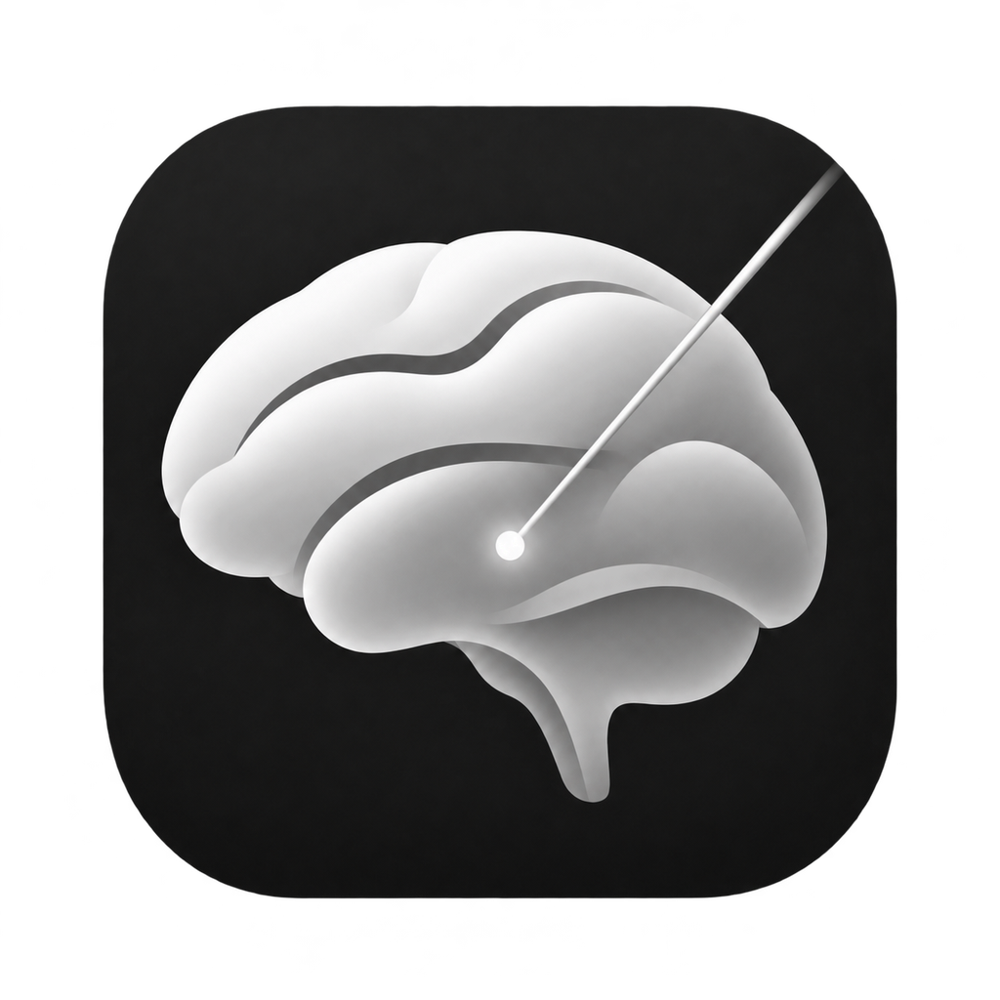

# Brainana Target

**Very early alpha — shared for exploration and feedback.**

Brainana Target is a preliminary app for anatomical targeting, implant planning, and reviewing electrode placement. We are making it public to share it with a small group of early alpha testers. This is for brave souls who are happy to explore unfinished software and tell us what is useful, what is confusing, and what is not worth keeping.

Expect bugs, rough edges, incomplete workflows, and changes between versions. We want feedback on the ideas and the workflow as much as on individual bugs. This is an exploratory research prototype; its fit checks, trajectories, hardware models, and template anatomy have not been validated for surgical decisions.

## What you can explore

- Load aligned MRI, CT, cortical surfaces, atlases, and functional maps in linked slice and 3D views.
- Build and edit a planning surface from CT or estimate a boundary from MRI.
- Define targets and regions to avoid; specify chambers, guide grids, headposts, and electrodes.
- Try manual placement and automatic fitting, inspect reach constraints, compare grid-hole trajectories, and review modeled overlaps.
- Display a stereotaxic setup and use reference points and measurements during review.
- Review measured electrode tracks against cortex and compare them with a saved plan.
- Save portable `.brainana-plan` projects and export reports and coordinates.
- Start with the bundled NMT macaque demo. **Guided tutorial** follows a planning workflow; **Demo tutorials** is a separate, step-by-step demonstration with limited practice.

Some of these areas are much further along than others. A visible model or a successful fit is something to inspect critically, not proof of anatomical or mechanical accuracy.

## Download and install

Choose an **early-alpha prerelease** on the [Releases page](https://github.com/brainana/brainana-target/releases). Installers include the app and the macaque demo; you do not need Node.js or a separate Python installation to run them.

| Computer | Download |
|---|---|
| macOS — Apple Silicon | `brainana-target-VERSION-arm64.dmg` |
| macOS — Intel | `brainana-target-VERSION-x64.dmg` |
| Windows x64 | `brainana-target-setup-VERSION-x64.exe` |
| Linux x64 | `brainana-target-VERSION-x86_64.AppImage` or `brainana-target-VERSION-amd64.deb` |

A Mac ZIP and a Windows portable ZIP are alternatives. Extract the whole ZIP before launching. Source code is provided separately for developers.

- **macOS:** Open the DMG and drag BrainanaTarget into Applications. Check Apple menu → About This Mac if you are unsure which chip you have. These alpha builds are ad-hoc signed, not Apple-notarized; macOS may require approval in System Settings → Privacy & Security after the first launch attempt.
- **Windows:** Run the installer. These alpha builds do not have a verified publisher signature, so Windows may show a SmartScreen prompt.
- **Linux:** Install the `.deb`, or make the AppImage executable with `chmod +x brainana-target-VERSION-x86_64.AppImage` and launch it. The builds use Ubuntu 22.04 as their build/test baseline. AppImage may require FUSE support.

The viewer requires WebGL2. Release downloads include platform manifests, validation reports, and `SHA256SUMS.txt`. The [full release ZIP](https://github.com/brainana/brainana-target/releases) collects the installers, source, documentation, and checksums in one download.

## First things to try

1. Choose **Try the macaque demo** on Home. It includes an NMT MRI, cortical surfaces, atlases, maps, and the MEBRAINS CT estimate aligned to NMT.
2. Open **Demo tutorials** for a walkthrough of image selection, slice navigation, contrast, blending, opacity, layout, and 3D controls. The regular panels remain in place; practice is limited to the controls for each step. Exiting returns to your original workspace.
3. Open **Planning surface** and examine the CT threshold and surface preview. Inspect all three planes before finalizing a boundary.
4. Define a target and some hardware, then try positioning. Read the feedback when a placement fails: total shaft length, the shaft reserved above a grid, and usable insertion length are different quantities.
5. Save a project so you can reopen it or share a reproducible example with us.

Additional images must already be aligned to the reference image. Target does not register MRI and CT. [Brainana Align](https://github.com/brainana/brainana-align) can help prepare aligned inputs.

The demo CT is a warped population estimate, not a CT acquired from the NMT subjects. It uses a 0.5 mm NMT grid with expanded coverage to retain the skull crown. Its original MEBRAINS geometry is 0.4 mm. [Sources and derivation](datasets/demo_viewer/nmt2sym/MEBRAINS-CT.md) explain the limitations.

## Help us decide what is useful

Please [open an issue](https://github.com/brainana/brainana-target/issues/new/choose) with either a bug report or general feedback. In particular:

- What were you trying to do, and which part helped?
- Which controls or explanations were confusing?
- Which features would you actually use, and which would you drop?
- What did you expect to happen, and what happened instead?

For bugs, include the app version, operating system, and a short sequence of steps. A small example using the bundled demo is especially helpful. Screenshots and a saved project can help when you are able to share them.

## Documentation and source

- [Early-alpha testing notes](Documentation/ALPHA_TESTING.md)
- [Build and release instructions](Documentation/BUILD.md)
- [Architecture](Documentation/ARCHITECTURE.md)
- [Validation and its limits](Documentation/VALIDATION.md)
- [Changes in this release](Documentation/CHANGELOG.md)
- [Contributing](CONTRIBUTING.md)

The repository uses npm workspaces: `apps/planner` contains the app, `packages` contains shared runtime and rendering code, `datasets` contains the demo, and `.github/workflows` builds native platform installers. It is a standalone repository; Brainana Viewer is not required.

To run from source with Node.js 24 LTS:

```sh
git clone https://github.com/brainana/brainana-target.git
cd brainana-target
npm ci
npm run build
npm run dev
```

## License and credits

The application source retains its **AGPL-3.0-only** license. Shared code originated in [Brainana Viewer](https://github.com/brainana/brainana-viewer). Demo templates, maps, surfaces, fonts, and dependencies retain their respective licenses and citations; the application license does not replace them. See [NOTICE.txt](NOTICE.txt), the demo's source manifest, and the included reference files.
